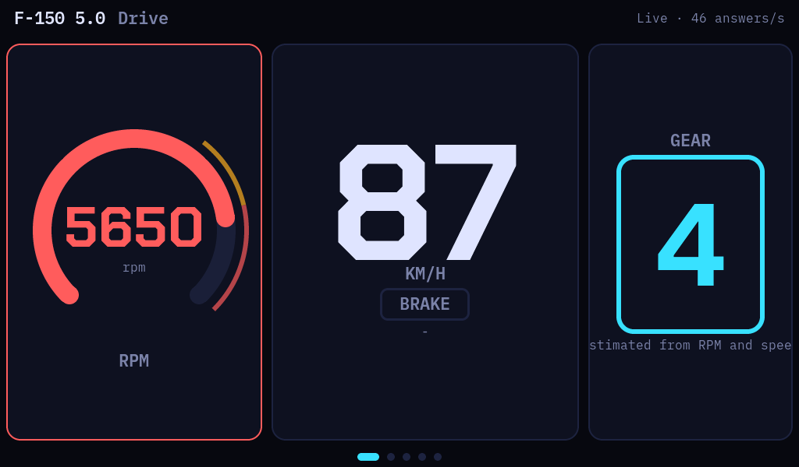

# F-150 dash firmware (ESP32-P4, 7")

Firmware for the **Waveshare ESP32-P4-WIFI6-Touch-LCD-7B** (7", 1024×600 touchscreen with a CAN connector).
It reads the truck directly from the CAN bus: no Bluetooth adapter, no phone.

Pages (swipe left/right): **Drive** (RPM, speed, gear, brake guess) · **Temperatures** (coolant, transmission, intake air)
· **Engine** (load, throttle, battery volts) · **Fuel** (level, long-term fuel trim bank 1 and bank 2) · **Settings**.



## Safety

- **Read-only.** It only asks for standard OBD-II values (mode 01) and one Ford read (mode 22, trans temp).
  It never writes, clears codes, or controls anything.
- **Listen-only first.** On first boot the CAN controller sends nothing at all (not even acknowledgements).
  Check that the Settings page shows traffic, then tap **Read data from truck**.
- **Fuse the 12 V wire** and keep the board out of direct sun: it is rated to 65 °C.

## Parts

| Part | Notes |
|---|---|
| Waveshare ESP32-P4-WIFI6-Touch-LCD-7B | the board this firmware targets |
| OBD-II splitter or pigtail cable | keeps the port free for FORScan |
| 12 V → 5 V USB-C car converter (3 A) | the board is powered over USB-C |
| Inline fuse holder, 2 A | on the 12 V feed |

## Wiring

| OBD-II pin | Signal | Board |
|---|---|---|
| 6 | CAN-H | CAN connector H |
| 14 | CAN-L | CAN connector L |
| 4 or 5 | Ground | CAN connector GND, and converter ground |
| 16 | +12 V (always on) | fuse → USB-C converter input |

Pin 16 is live with the truck off. The screen switches off a minute after the bus goes quiet, but the board still
draws power. For daily use, take +12 V from an **ignition-switched** fuse (add-a-fuse tap) instead of pin 16.

## Build and flash

Needs **ESP-IDF 5.5 or newer** (Espressif's installer, or the VS Code ESP-IDF extension).

```sh
cd firmware
idf.py set-target esp32p4
idf.py build
idf.py -p COM5 flash monitor    # your port; on Mac/Linux e.g. /dev/ttyACM0
```

The first build downloads the board package and LVGL 9.5 (same versions as Waveshare's own
`09_lvgl_demo_v9` example).

## First drive checklist

1. Flash, plug in, ignition on. Settings page → **frames/s** and **Busiest IDs** appear: wiring and bus speed are right.
   If it says "No bus traffic", swap CAN-H/CAN-L and check ground.
2. Tap **Read data from truck**. The top bar shows **Live · N answers/s**; gauges come alive.
3. Compare coolant and RPM with the cluster, and **trans temp** with FORScan's TFT once (its formula is community-sourced).

## Tests and screen previews (no board needed)

```sh
./test/run.sh                                    # logic tests: OBD decoding, ISO-TP, gears, brake, warning levels
LVGL_DIR=/path/to/lvgl-v9.5.0 ./host/build.sh    # renders every page to host/out/*.ppm
```

## Code map

- `main/dash_core.*` – portable logic: OBD request/decode, ISO-TP, gear estimate (6R80 ratios, 25.82 rpm per km/h
  from your FORScan log), brake guess, warning limits.
- `main/dash_ui.*` – LVGL screens.
- `main/main.cpp` – board setup, CAN driver (pins 22/21), request schedule, settings in flash.
- `main/fonts/` – Chakra Petch and IBM Plex Mono, converted with `lv_font_conv`.
